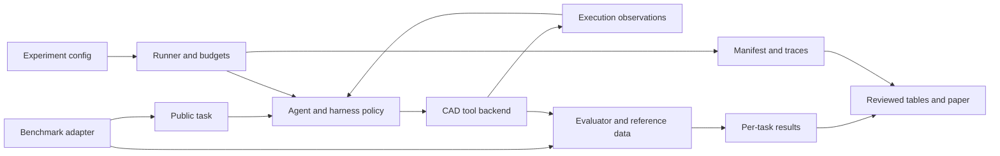

# Harness architecture

研究对象暂定「在固定基础模型与预算下，CAD agent 的工具、状态和反馈机制如何影响可执行建模与修改表现」。目前实现仅为离线 smoke 基座。

## Extension boundaries

| Boundary | Responsibility | Initialization status |
| --- | --- | --- |
| Task / benchmark | 将官方样本转换为公开任务，并单独保留评价数据 | 两个合成 box 样例；官方 adapter 待实现 |
| Agent | 根据公开任务与工具观察选择下一步 action | 确定性脚本 smoke；LLM provider 待实现 |
| Backend | 执行动作，返回观察及产物 | mock 元数据；真实 CAD 内核待实现 |
| Evaluator | 按指定协议评分，输出逐题状态 | 仅合成元数据检查；官方 scorer 待接入 |
| Runner | 配置、预算、失败记录与运行产物 | 支持本地 smoke |
| Proposed harness | 状态管理、验证反馈、修复策略等研究变量 | 待基线错误分析后提出并验证 |

benchmark 的参考数据只能流向 evaluator。真实 agent 接口还应区分公开示例与测试答案，记录可见模态和工具反馈，避免对照实验获得不同信息。

## Real CAD integration

优先在一个小型公开任务子集上接入 headless CAD backend：固定内核版本，导出可重载 CAD/STEP 产物，验证执行与实体有效性，再对齐官方 scorer。CADQuery/build123d/FreeCAD 属于候选后端，应由所选 benchmark 的协议决定，而不是先统一替换上游环境。

生成的 CAD 代码应通过有超时、资源边界与工作目录隔离的执行器运行；当前 mock backend 不执行任意生成代码，因此本仓库尚不提供真实代码执行隔离。正式 runner 的模型调用、token、费用和进程超时需要在真实 provider/backend 接入时实现并验证。

smoke 只验证配置、动作、观察、逐题结果与 manifest 的连通性，不验证曲面、拓扑、布尔操作或模型推理质量。
